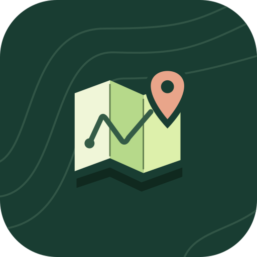
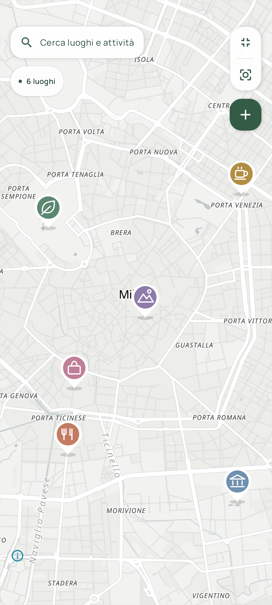
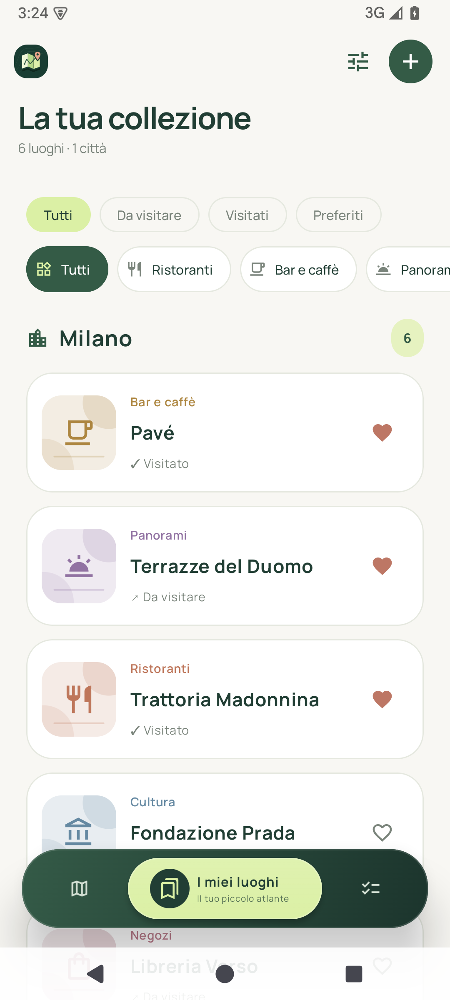
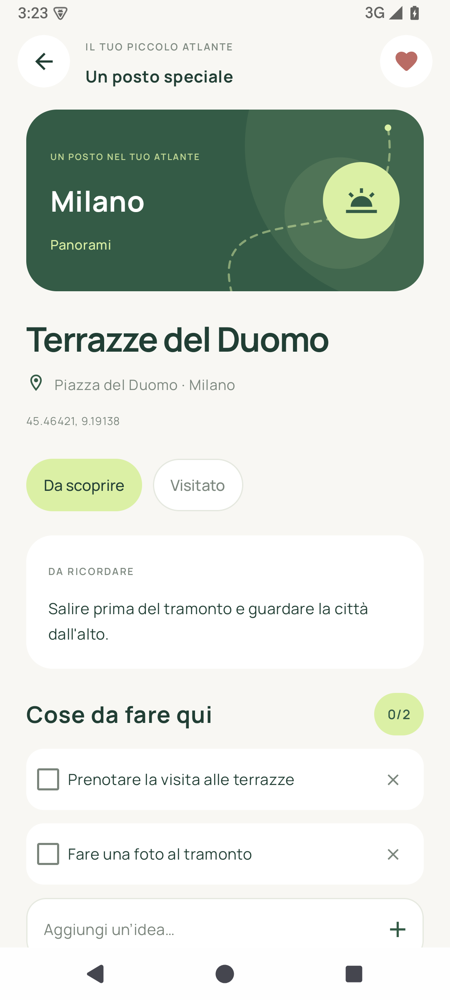

<p align="center">
  
</p>
<h1 align="center">Mappinando</h1>
<p align="center"><strong>Il tuo piccolo atlante personale.</strong><br />I posti del cuore. Quelli di domani.</p>
<p align="center">
  
  
  <a href="https://github.com/carellice/Mappinando/releases/latest"></a>
  
</p>
<p align="center">
  <a href="https://github.com/carellice/Mappinando/releases/latest"><strong>Scarica l’APK</strong></a> ·
  <a href="docs/ANTEPRIMA.md">Guarda l’app</a> ·
  <a href="https://github.com/carellice/Mappinando/issues">Segnala un problema</a>
</p>

Mappinando è un’app Android nativa per raccogliere i luoghi che ami e quelli che vuoi visitare. Segna un punto sulla mappa, dagli una categoria e annota le cose che ti va di fare: un ristorante da provare, un panorama da fotografare, una piccola scoperta da ricordare.

Verde bosco, crema, accenti lime, icone illustrate e animazioni curate accompagnano un’interfaccia interamente in italiano. Senza account, pubblicità o abbonamenti.

<table>
  <tr>
    <th>Esplora</th><th>I miei luoghi</th><th>Ogni tappa, le sue idee</th>
  </tr>
  <tr>
    <td></td>
    <td></td>
    <td></td>
  </tr>
</table>

## Un posto per tutte le tue scoperte

- **Mappa immersiva:** espandila a tutto schermo, cerca un punto o tieni premuto per segnare un luogo. I comandi restano a portata di mano.
- **Ricerca gratuita:** città, indirizzi e attività per nome, con priorità alla zona della mappa. Seleziona un risultato, esploralo e poi decidi se aggiungerlo alle tappe.
- **Sei categorie:** Ristoranti, Bar e caffè, Panorami, Cultura, Negozi e Natura, con filtri sulla mappa e nella raccolta.
- **Luoghi per città:** ritrova le tappe salvate, i preferiti e i posti già visitati. Le intestazioni si comprimono scorrendo per lasciare spazio alle liste.
- **Le cose da fare:** ogni luogo può avere note e una checklist. La sezione Da fare riunisce tutte le attività.
- **Verifica su Google Maps:** dall’anteprima apri l’indirizzo selezionato per controllarlo meglio, prima di salvarlo.
- **Aggiornamenti dall’app:** controlla le release GitHub, scarica l’APK e installa la nuova versione con la conferma di Android.

Al primo avvio trovi sei luoghi di esempio a Milano. Puoi modificarli o eliminarli: non ricompariranno dopo la cancellazione.

## Installa Mappinando

1. Apri [l’ultima release](https://github.com/carellice/Mappinando/releases/latest) e scarica il file **`.apk`** dagli allegati.
2. Aprilo sul telefono e, se Android lo richiede, consenti l’installazione da questa origine.
3. Avvia Mappinando. Serve **Android 8.0 o successivo**, con OpenGL ES 3.0.

Gli APK sono firmati per l’installazione diretta. Per aggiornare una versione esistente installa il nuovo APK senza disinstallare l’app: luoghi, note e attività resteranno salvati.

### Aggiorna direttamente dall’app

Apri le informazioni dal pulsante con la bussola e scegli **Aggiornamenti dell’app**. Se c’è una versione più recente, puoi scaricarla e premere **Installa aggiornamento**. La prima volta Android può chiedere di autorizzare Mappinando a installare aggiornamenti: la conferma finale rimane sempre nelle mani dell’utente.

L’app controlla anche la disponibilità di nuove release all’avvio, al massimo una volta al giorno. Puoi rimandare l’avviso e tornare a controllare manualmente. Prima dell’installazione vengono verificati integrità SHA-256, identificativo dell’app, versione e firma dell’APK. [Come funziona](docs/AGGIORNAMENTI.md).

## I tuoi dati restano tuoi

Luoghi, note, preferiti e attività vengono salvati **localmente sul dispositivo** e restano consultabili offline. Non servono un account o l’accesso alla posizione. Questa versione non sincronizza i dati: disinstallare l’app elimina la raccolta locale.

La mappa richiede Internet e usa **OpenFreeMap**, con dati **OpenStreetMap / OpenMapTiles**. La ricerca combina **Photon**, ospitato da komoot, e il servizio indirizzi **Android Geocoder**, se disponibile. Non servono chiavi API o servizi a pagamento.

La copertura dei locali dipende dai dati disponibili. Le corrispondenze parziali sono distinte dai risultati pertinenti; gli indirizzi non accompagnati da una scheda del locale vengono mostrati come **Indirizzi da verificare**. Con **Non lo trovi? Aggiungilo per indirizzo** puoi cercare l’indirizzo e indicare tu il nome da salvare. Nessuna tappa viene creata automaticamente.

Le ricerche online partono solo quando premi Cerca. Photon riceve testo, filtro e centro approssimativo della mappa; il servizio Android riceve il testo cercato. Per gli aggiornamenti viene contattata la repository pubblica GitHub. **Verifica su Google Maps** apre un normale collegamento esterno nell’app Maps o nel browser.

## Sviluppo

Il progetto usa **Kotlin, Jetpack Compose e MapLibre Native**, con Gradle wrapper incluso.

| Componente | Versione |
| --- | --- |
| Android minimo | 8.0 / API 26 |
| Compile / target SDK | 36 |
| Kotlin | 2.2.20 |
| Jetpack Compose BOM | 2025.09.01 |
| MapLibre Native OpenGL | 13.6.1 |
| Android Gradle Plugin | 8.13.0 |
| Gradle | 8.13 |
| JDK | 17 o successivo compatibile; sviluppo verificato con 21 |

Clona la repository, aprila in Android Studio e configura l’SDK Android. Da PowerShell:

```powershell
.\gradlew.bat :app:assembleDebug
.\gradlew.bat :app:testDebugUnitTest :app:lintDebug
```

Per generare un APK con nuova versione fai doppio clic su **COMPILA APK.bat**. Lo script esegue build, test e Lint; solo se riescono aggiorna `version.properties` e conserva APK, hash e metadati nella cartella locale `releases/`.

### Pubblicare una release su GitHub

Fai commit delle modifiche e sincronizza `main` con GitHub, poi fai doppio clic su **PUBBLICA RELEASE.bat** oppure esegui:

```powershell
powershell.exe -NoProfile -ExecutionPolicy Bypass -File .\scripts\Publish-Release.ps1
```

Lo script incrementa la versione, verifica build e firma, crea il commit di versione e il tag, carica APK e metadati in una bozza e la pubblica solo quando gli allegati sono completi. Se il caricamento si interrompe, **`-Resume`** riprende il rilascio senza consumare una nuova versione. **`-DryRun`** mostra cosa verrebbe pubblicato senza modificare nulla.

Servono Git, GitHub CLI autenticata con `gh auth login` e la stessa chiave usata per gli APK già distribuiti. Le chiavi private e le credenziali non fanno parte della repository. [Guida completa ai rilasci](docs/RILASCI.md).

## Struttura del progetto

```text
app/src/main/java/it/mappinando/app/
├── data/       Luoghi, attività e persistenza locale
├── map/        Mappa nativa, ricerca e collegamento a Google Maps
├── ui/         Schermate Compose, transizioni e navigazione sospesa
└── updates/    Release GitHub, download e verifica degli APK
scripts/        Build, versionamento, pubblicazione e relativi test
docs/           Anteprime, guide e verifiche
licenses/       Licenze delle risorse e dei componenti inclusi
```

## Crediti

[OpenStreetMap](https://www.openstreetmap.org/copyright), [OpenFreeMap](https://openfreemap.org/), [MapLibre Native](https://github.com/maplibre/maplibre-native), [Photon](https://github.com/komoot/photon) e [Manrope](https://manropefont.com/). Font e dipendenze mantengono le rispettive licenze; quelle incluse nel progetto sono nella cartella [licenses](licenses/). Logo, piccoli disegni e segnaposti sono risorse vettoriali del progetto.
