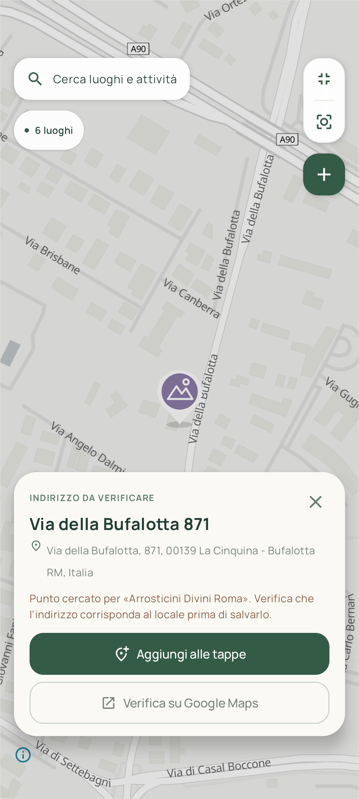
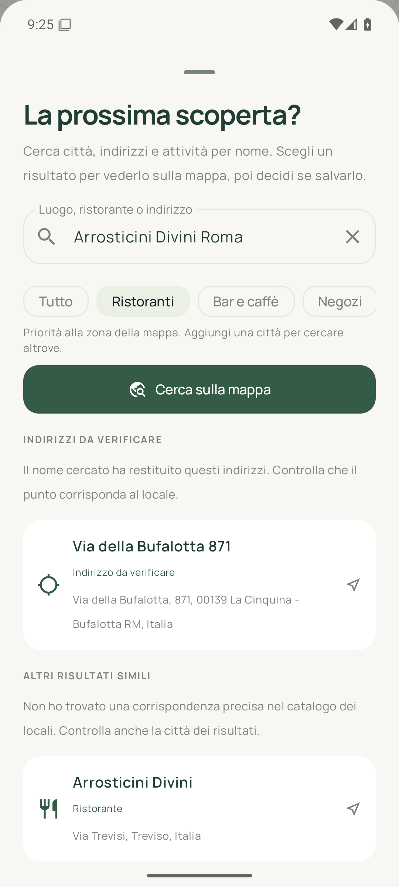
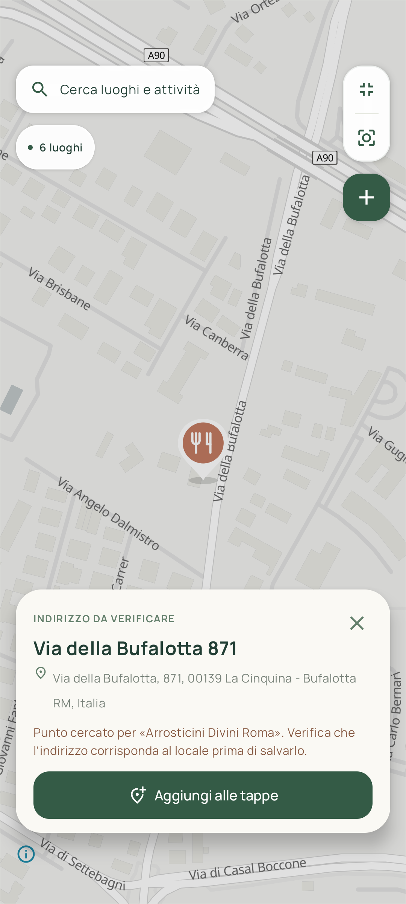
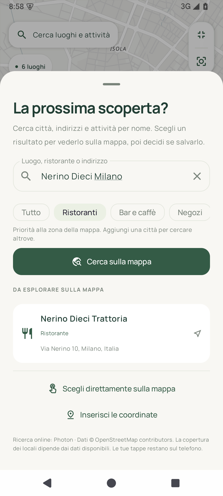
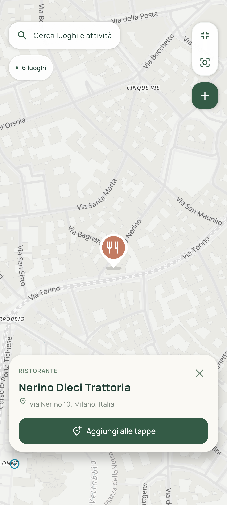

# Mappinando 1.0.6

Schermate reali acquisite su Android 15. Sono mostrati i sei luoghi di esempio a Milano.

[Guarda la transizione corretta della mappa, in apertura e chiusura](mappinando-map-fixed.mp4).

## Esplora

## Mappa immersiva

## Cerca un locale, poi decidi se salvarlo

Il pulsante **Verifica su Google Maps**, sotto Aggiungi alle tappe, apre l’indirizzo selezionato nell’app Google Maps oppure nel browser. La tappa rimane provvisoria quando torni a Mappinando.

La ricerca gratuita combina ora Photon e il servizio indirizzi Android. Nella prova reale di **Arrosticini Divini Roma** l’indirizzo restituito viene presentato come suggerimento da verificare, prima dei risultati simili di altre città.

Ricerca reale di **Nerino Dieci Milano**, con filtro Ristoranti. Nessuna tappa viene creata selezionando il risultato.

## I miei luoghi

## Un luogo, tante idee

## Da fare

## Icona originale

[Versione vettoriale dell’icona](mappinando-icona.svg)
